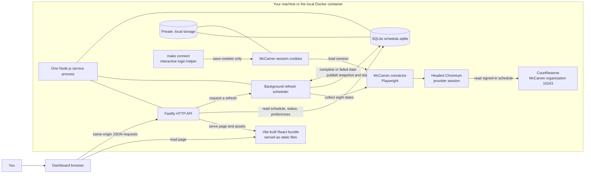
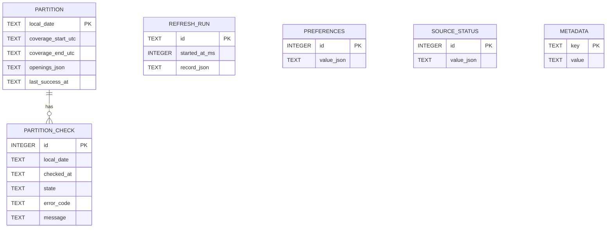
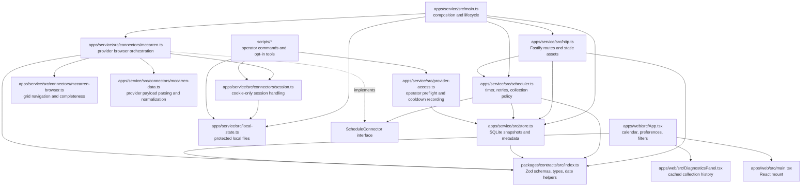

# Architecture and code tour

This guide describes the **code that exists today**, rather than the wider multi-venue product in the implementation plan.

For a click-through diagram of the main runtime flows, see the [interactive architecture companion](architecture-diagram.md) or open **http://127.0.0.1:4317/architecture** while the local service is running.

## The short version

This is a local, read-only McCarren Tennis Center calendar. One Node.js service runs the HTTP API and a background collector. The collector uses Playwright to read McCarren's signed-in schedule, saves validated snapshots in SQLite, and the React page reads those snapshots from the API. The app links out to McCarren for booking; it does not book a court.

The central design idea is:

> **The collector updates the cache; the dashboard displays the cache.** Loading or refreshing the dashboard does not scrape CourtReserve.

## 1. High-level architecture



`apps/service/src/main.ts` is the assembly point: it creates the store, connector, scheduler, and Fastify app, then starts the API and scheduler. The page and API share one origin, normally `http://127.0.0.1:4317`. In Docker, the browser-facing port is still published only on loopback; Chromium runs inside the container with a virtual display.

There are two independent clocks: provider collection is disabled by default and, when explicitly enabled, runs every `REFRESH_SECONDS` (default 900) after the previous cycle completes; an open dashboard rereads the local cache every 15 seconds. The faster page poll does not increase provider traffic.

There are two different browser roles in the picture:

- **Dashboard browser:** renders the React calendar and requests local API data.
- **Provider browser:** Playwright launches headed Chromium for a collection, reads the eight-date schedule as the connected account, and closes the browser when that collection finishes.

The optional `make connect` helper is a separate interactive login flow. It saves only provider cookies under `.local/mccarren/`; it does not save a password or send session data to the dashboard. It refuses provider access while local collection is paused or a known cooldown is active.

## 2. One refresh, from timer to calendar

```mermaid
sequenceDiagram
  participant T as Scheduler timer
  participant S as RefreshScheduler
  participant C as McCarrenConnector
  participant B as Playwright / CourtReserve page
  participant P as CourtReserve
  participant DB as ScheduleStore / SQLite
  participant UI as Dashboard browser
  participant API as Fastify API

  T->>S: Check whether collection is due
  S->>S: Check saved-session revision and provider cooldown
  alt cooldown active, login missing, or source paused
    S->>DB: Preserve cached schedule; update status / next due
  else collection may run
    S->>C: collect(today, 8 dates)
    C->>B: Launch headed browser context for this collection
    B->>P: Read organization, grid configuration, and date schedule
    loop Each of the eight New York dates
      C->>B: Navigate to date and inspect full court/time grid
      B->>P: Load date schedule through normal site UI
      C->>C: Validate response and full rendered grid
      alt date is complete
        C-->>S: Complete partition with observed Reserve starts
        S->>DB: Validate and atomically replace that date's snapshot
      else date failed or grid incomplete
        C-->>S: Failed partition with safe error details
        S->>DB: Record failed check; keep last complete snapshot
      end
    end
    S->>DB: Store run summary, source health, and next due time
  end

  loop While the dashboard is open
    UI->>API: GET /api/schedule (up to 7 display dates)
    API->>DB: Read cached partitions, preferences, and revision
    DB-->>API: Snapshot and per-date coverage/freshness
    API-->>UI: Validated JSON response
    UI->>UI: Apply view and filters; render date status and starts
  end
```

### What the collector considers a usable observation

The production connector is browser-based. It correlates the normal signed-in page with validated schedule responses, then reads the provider's rendered **Reserve** controls from the full grid. It scrolls through the seven configured court columns and the source's 06:00–23:59 New York-local schedule; it does not treat the initially visible part of the page as a complete day. A changed date, a missing cell, a loading state, an unexpected response, or an incomplete grid prevents that date from being published as complete.

Each accepted marker becomes one `reserve-start` opening. Its duration, end time, price, and eligibility are currently unknown. The connector does not combine adjacent starts into a made-up longer reservation and does not use any booking or payment flow.

The scheduler requests **eight dates: today plus seven ahead**. This is the provider's observed posted range. The API limits one dashboard response to seven dates; the eighth cached date can be reached by navigating forward.

## 3. The three schedule facts to keep separate

The UI and service distinguish three questions that are easy to conflate:

| Concept                       | Meaning in this app                                                                           | Example                                                                                                 |
| ----------------------------- | --------------------------------------------------------------------------------------------- | ------------------------------------------------------------------------------------------------------- |
| **Opening observation**       | A specific `Reserve` start control was observed for a court and local time.                   | Court #2 has a 6:00 p.m. start marker.                                                                  |
| **Coverage**                  | Whether the requested date's configured schedule grid was checked completely.                 | `complete` means every configured court/time cell was checked; `unknown` means that is not established. |
| **Source health / freshness** | Whether McCarren collection is currently working and the cached observation is recent enough. | `healthy`, `partial`, `rate-limited`, `needs-login`, or stale.                                          |

Consequently, **a missing marker is not proof that a time is booked**, and a failed refresh is not proof that there are no starts. If a later check fails, the previous successful date snapshot remains visible with its older timestamp and an error/stale indication. Even a complete grid only establishes what the provider displayed during that check; it does not establish eligibility or a reservable duration.

The source is marked healthy only when all eight requested dates complete. A partially completed cycle may update verified dates while failed dates retain their previous snapshots; the overall source state reports that the run was partial or failed.

Date-only values are New York local dates (`America/New_York`). Start/coverage timestamps are instants with UTC offsets. Luxon handles conversions and date arithmetic so the date walk does not assume every local day is 24 hours.

## 4. Low-level storage design



This is one SQLite database at `.local/schedule.sqlite`, using write-ahead logging (WAL). The current schema is migration version 3. A `PARTITION` is the latest authoritative snapshot for one New York local date; its openings are serialized together as JSON. `PARTITION_CHECK` is the attempt history for dates. `REFRESH_RUN` records each overall collection cycle. Preferences and source status are singleton JSON records. Metadata stores the revision counter and scheduler controls such as a persisted provider cooldown and a paused session revision.

Publishing a complete partition is a transaction: validate its date, coverage interval, unique opening IDs, and court/start pairs, then replace that date's snapshot and record the successful check. Publishing a failed partition only adds a failed check; it does **not** replace the snapshot or advance its last-success time. This replacement boundary is what prevents partial data from erasing a previously complete day.

## 5. Code design and responsibilities



| Area                       | Main files                                                            | Responsibility                                                                                                                                                    |
| -------------------------- | --------------------------------------------------------------------- | ----------------------------------------------------------------------------------------------------------------------------------------------------------------- |
| Composition and lifecycle  | `apps/service/src/main.ts`                                            | Configure local storage, construct the service objects, start listening/collection, and handle shutdown.                                                          |
| Shared contract            | `packages/contracts/src/index.ts`                                     | Zod runtime schemas and inferred TypeScript types used at connector, API, persistence, and UI boundaries. Also defines New York date helpers.                     |
| Provider adapter           | `apps/service/src/connectors/mccarren.ts`, `session.ts`               | Playwright lifecycle, login/organization checks, date navigation, response correlation, normalization, and safe failure classification.                           |
| Browser-grid helpers       | `apps/service/src/connectors/mccarren-browser.ts`, `mccarren-data.ts` | Validate and traverse the full CourtReserve grid; parse provider response metadata and convert verified starts into the app's shape.                              |
| Shared local state         | `apps/service/src/local-state.ts`                                     | Symlink-safe, permission-restricted JSON state used by the service, connector session, and operator commands.                                                     |
| Refresh policy             | `apps/service/src/scheduler.ts`                                       | One-at-a-time polling, session-change detection, manual-request coalescing/deferral, timeouts, retry/backoff, provider cooldowns, source status, and run history. |
| Persistence                | `apps/service/src/store.ts`                                           | SQLite migrations, transactional partition replacement, cached reads, preferences, status, and diagnostics history.                                               |
| HTTP boundary              | `apps/service/src/http.ts`, `diagnostics.ts`                          | Validate API input/output, return cached state, accept refresh requests, serve built UI files, and calculate collection freshness.                                |
| User interface             | `apps/web/src/App.tsx`, `DiagnosticsPanel.tsx`, `main.tsx`            | Poll the local API, manage date/view/filter/preferences state, render the calendar and source freshness, and link out to the provider.                            |
| Provider-access operations | `apps/service/src/provider-access.ts`                                 | Read-only operator permission checks and durable recording of observed provider cooldowns; used by CLI tools.                                                     |
| Operations                 | `scripts/`, `Makefile`, `Dockerfile`, `compose.yaml`                  | Supported login/collection/status commands, provider diagnostics, opt-in acceptance checks, incident maintenance tools, and the one-container local runtime.      |

`ScheduleConnector` is the useful seam for a future provider adapter: the scheduler asks for a bounded range and receives complete or failed date partitions. In this implementation the contract is intentionally McCarren-specific in several places (`sourceId`, transport, facility route, and literal schema values), so it is **not yet a drop-in multi-provider framework**.

The directory structure looks like a monorepo, but the current pnpm workspace lists only the root package (`.`). These folders are code boundaries, not independently published/installable packages: TypeScript compiles the project together, and imports use relative paths. Tests sit next to the service, connector, UI, and helper code they exercise.

`scripts/connect.ts`, `collect.ts`, and `status.ts` are recurring operator entry points. Provider inspection and the older feasibility probe live under `scripts/diagnostics/`; browser/runtime acceptance checks live under `scripts/checks/`; incident-state recording lives under `scripts/maintenance/`. These tools import backend implementation, while the running service does not import scripts. Session loading/saving is shared through `connectors/session.ts`. The scheduler owns scheduled refresh policy; `provider-access.ts` owns operator preflight and observed-rate-limit persistence, using the same persisted provider deadline.

## 6. HTTP and build/runtime path

| Route                                                 | What it does                                                                                                                 |
| ----------------------------------------------------- | ---------------------------------------------------------------------------------------------------------------------------- |
| `GET /` and `/assets/*`                               | Serves the Vite-built React app from the same local service.                                                                 |
| `GET /api/schedule`                                   | Reads SQLite snapshots for a validated New York date range (maximum seven display dates). It does not contact CourtReserve.  |
| `GET /api/sources`, `/api/diagnostics`                | Returns source health and cached collection/run history.                                                                     |
| `GET` / `PATCH /api/preferences`                      | Reads or persists local calendar preferences.                                                                                |
| `POST /api/refresh-requests`                          | Asks the scheduler to refresh; returns `accepted`, `coalesced`, or `deferred`. It does not bypass cadence or cooldown rules. |
| `/health/live`, `/health/ready`, `/health/collection` | Separately report process liveness, local storage readiness, and provider collection freshness.                              |

`pnpm build` runs TypeScript compilation and Vite, producing service code under `dist/` and the browser assets under `dist/web/`. The Fastify service serves those exact emitted web assets. `make dev` builds then runs the service against source; `make up` builds the Docker image and starts the compiled service. The image includes headed Chromium and Xvfb because this provider blocked headless access. Compose mounts `.local/` so the SQLite database and login session outlive container recreation. Run only one runtime at a time because both use the same state and provider request budget.

## 7. Prototype boundaries and current operating status

- The live implementation is **McCarren indoor only**. USTA, NYC Parks, other venues, a static court catalog, and notifications are planned or deferred, not current integrations.
- It is a single-user, local app. There is one service process, one SQLite store, and one McCarren session. This keeps the prototype understandable and easy to run, but it is not yet a multi-user or horizontally scaled design.
- CourtReserve's UI is part of the integration. Provider page/layout changes can require connector maintenance even though the code checks schedule responses and grid completeness.
- Reservation duration, end time, price, eligibility, and exact release time are not established from the verified reads. The UI preserves these as unknown rather than inventing values.
- The latest execution/incident notes report a repeat home-network CourtReserve `429` after 11 successful 15-minute cycles. Collection is disabled by default while an acceptable request budget/cadence is unconfirmed. Treat cached observations as historical until a complete provider read succeeds; a healthy local HTTP service is not evidence that provider collection is fresh. See [`docs/execution.md`](execution.md), [`docs/incidents/2026-10-31-mccarren-rate-limit.md`](incidents/2026-10-31-mccarren-rate-limit.md), and the dashboard diagnostics for current status.

For the evidence behind the connector and its coverage claims, see [`docs/sources/mccarren.md`](sources/mccarren.md). For the exact API shapes, see [`docs/api.md`](api.md). The broader target and deferred milestones are in [`docs/implementation-plan.md`](implementation-plan.md).

## 8. Suggested code-reading order

1. `packages/contracts/src/index.ts` — learn the data vocabulary (`Opening`, `PartitionResult`, `PartitionView`, and `SourceStatus`).
2. `apps/service/src/main.ts` — see how the application is assembled.
3. `apps/service/src/scheduler.ts` — follow polling, error handling, and publication.
4. `apps/service/src/connectors/mccarren.ts` — see how one provider date becomes a complete or failed partition.
5. `apps/service/src/store.ts` — understand what survives failures and restarts.
6. `apps/service/src/http.ts` — trace API requests to the cache.
7. `apps/web/src/App.tsx` — see the API data become the visible calendar and filters.

If you remember only three things: **the dashboard reads cache; complete per-date checks replace cache, while failures preserve it; and a listed start is an observation, not a confirmed bookable reservation.**
